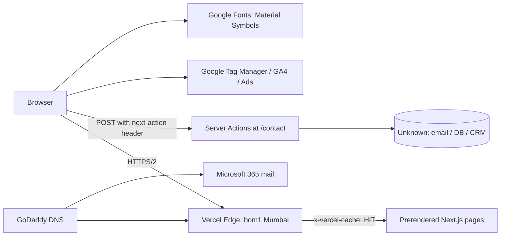

# Backend Technical Audit: cynbit.in

**Date:** 30 Oct 2026 · **Type:** Passive, black-box · **Target:** https://www.cynbit.in

## 1. Scope and method

Only passive, low-volume techniques were used:

| Technique | Detail |
|---|---|
| HTTP header inspection | Single `curl -I` requests to `www`, apex and `http://` |
| Public files | `robots.txt`, `sitemap.xml`, `/.well-known/security.txt` |
| DNS | Public `dig` lookups (A, MX, TXT, `_dmarc`) |
| Lighthouse 13.4.1 | One mobile run (Moto G Power, Slow 4G) |
| Browser DevTools | Observed the site's own form requests |
| Form submissions | **Three** test submissions to the contact/newsletter forms with clearly labelled test data ("IGNORE, testing") |

**Not done:** no fuzzing, no injection payloads, no load or repeated requests, no requests to `/api/`, `/admin/` or `/portal/`, no authentication attempts, no scanning of other Cynbit products (TenantEase, Studio, Revio, BitElevate portal).

**Limitations:** HTTP response bodies and status codes for the form submissions were not captured, so server-side validation behaviour is *unverified* and is marked as such below.

## 2. Observed architecture

| Layer | Evidence |
|---|---|
| Framework | Next.js App Router (`x-nextjs-prerender: 1`, `vary: rsc, next-router-state-tree`, route group `(marketing)`, `/_next/static/*`) |
| Hosting/CDN | Vercel, Mumbai region (`x-vercel-id: bom1::...`), HTTP/2, A record `216.198.79.1` |
| Rendering | Static prerender, CDN `HIT`, `age: 92044` (~25.6 h), `cache-control: public, max-age=0, must-revalidate` |
| "API" layer | **Next.js Server Actions**, not REST. `POST /contact`, `accept: text/x-component`, `next-action: <id>` header. No JSON REST endpoints observed |
| Forms | (a) newsletter: body `["email"]` (text/plain); (b) contact: multipart with `fullName, email, company, industry, message` |
| DNS/mail | GoDaddy nameservers, MX to Microsoft 365, SPF to `secureserver.net`, DMARC `p=none` |
| Analytics | GA4 `G-LK6CQWCWX0`, Google Ads linker (`_gcl_au`, `gcl_ctr` in localStorage), GTM 194 KiB |

## 3. Findings

Severity is a judgement for a marketing site that collects contact details. "Verify" means the evidence suggests an issue but does not prove it.

### 3.1 Security

| ID | Finding | Severity |
|---|---|---|
| SEC-01 | No CSP, frame-ancestors/X-Frame-Options, COOP, X-Content-Type-Options, Referrer-Policy or Permissions-Policy | **Medium** |
| SEC-02 | HSTS lacks `includeSubDomains` and `preload` | Low |
| SEC-03 | Apex redirects to www with temporary 307; canonical signals all point at the apex | Low |
| SEC-04 | `robots.txt` advertises `/admin/`, `/portal/`, `/api/` | Low/Info |
| SEC-05 | Production source maps appear to be public (Lighthouse "valid source maps" passed) | Low, verify |
| SEC-06 | No `security.txt` (path returns the HTML 404 page) | Low |
| SEC-07 | `access-control-allow-origin: *` on the HTML document | Info, verify scope |
| SEC-08 | Next.js/React patch level not determinable externally | Verify |

**SEC-01.** *Evidence:* the `curl -I` output contains none of these headers; Lighthouse flags CSP, COOP, frame control and Trusted Types as High. *Risk:* the `/contact` form can be framed (clickjacking), and a 194 KiB third-party tag runs with no script allow-list, so any compromise or XSS has full page reach. *Fix:* `recommendations/next.config.ts`. Ship CSP as `Report-Only` first, then enforce.

**SEC-02.** Present: `max-age=63072000`. Missing: `includeSubDomains; preload`. Add them only after every subdomain (product apps, portal) serves HTTPS, because preload is hard to undo.

**SEC-03.** *Evidence:* `https://cynbit.in` returns `307 -> https://www.cynbit.in/`. Yet the sitemap `<loc>` values, the `Sitemap:` line in robots.txt, `og:url`, `og:image` and JSON-LD `@id/url` all use the **apex**, so every canonical URL costs a redirect, and 307 tells crawlers the move is temporary. *Fix:* choose one host, make the redirect 308 in the Vercel domain settings, and use `metadataBase` plus consistent URLs (`recommendations/sitemap-robots.ts`).

**SEC-04.** Disallow lines are a public map of sensitive paths and are not an access control. These paths were not probed. *Fix:* ensure those routes require authentication server-side and return `X-Robots-Tag: noindex`; drop them from robots.txt. `Crawl-delay` is ignored by Google and can be removed.

**SEC-05.** Lighthouse's source-map audit only passes when maps are served. Confirm by checking whether a first-party chunk ends with `//# sourceMappingURL=`. If so, original source (comments, internal routes, accidentally bundled keys) is readable. *Fix:* `productionBrowserSourceMaps: false`, or upload maps to your error tracker only.

**SEC-06.** RFC 9116 `security.txt` gives researchers a disclosure channel. Also confirm the 404 response status is actually `404` (not `200`, a "soft 404").

**SEC-07.** Vercel adds this to static assets by default and it is harmless for a public HTML page. Verify it is **not** present on any dynamic or action responses.

**SEC-08.** App Router with Server Actions is exposed. Check the Next.js/React versions against current security advisories (including the December 2025 React Server Components advisory, CVE-2025-55182) and keep dependencies patched.

### 3.2 Email and DNS

| ID | Finding | Severity |
|---|---|---|
| EML-01 | SPF authorizes only `secureserver.net` (GoDaddy) with `-all`, but MX points to **Microsoft 365** | **High** (deliverability and trust) |
| EML-02 | DMARC is `p=none` with no `rua` reporting | **Medium** |
| EML-03 | DKIM, MTA-STS, TLS-RPT, CAA not evidenced | Verify |
| EML-04 | TXT records disclose the M365 tenant and GoDaddy dependency | Info |

**EML-01.** Mail sent through Outlook/M365 is not covered by the SPF record, and `-all` instructs receivers to hard-fail everything else. Either legitimate mail is failing SPF (relying on DKIM alone) or mail is being sent from somewhere the SPF does not describe. For a company with a careers/internship funnel and `opportunities@cynbit.in`, spoofing and spam-foldering both matter. Also include whichever provider sends the contact-form emails.

**EML-02.** `p=none` is monitoring only: spoofed mail from `@cynbit.in` is still delivered, and without `rua` you receive no reports to learn who is sending. *Fix:* see `recommendations/dns-email.md`.

**EML-03.** `dig ANY` is unreliable. Check individually: `selector1._domainkey` / `selector2._domainkey` (CNAME), `_mta-sts`, `_smtp._tls`, and `CAA`.

### 3.3 API, input validation and data handling

| ID | Finding | Severity |
|---|---|---|
| API-01 | Backend is Server Actions: no versioned contract, and abuse controls must live inside each action | Medium, verify |
| API-02 | Server-side validation unverified (junk values were submitted, responses not captured) | Verify |
| API-03 | Newsletter takes a single email with no evidence of double opt-in | Medium, verify |
| API-04 | PII flow (name, email, company, message) has an unknown destination, retention and storage | Verify |
| PRV-01 | GA4 + Google Ads cookies/localStorage observed; consent ordering unknown | Verify |

**API-01.** Server Action IDs ship in the client bundle, so anyone can call them. Next.js compares `Origin` to `Host` as CSRF protection, which is good, but it does not provide authentication, rate limiting or bot protection. Observed request shapes are in the table in section 2.

**API-02.** Test inputs were `@@#%!` as a name, `123` as an industry and symbol-heavy messages. If the server accepts them, that is a validation gap, and header injection is a risk if fields flow into email headers. *Fix:* `recommendations/contact-action.ts` (schema validation, honeypot, Turnstile, rate limit, CR/LF stripping, generic errors, no PII in logs).

**API-03.** Two practical requirements: a confirmation email (double opt-in) and a working unsubscribe. The "25k+" subscriber claim on the page also needs backing.

**API-04 / PRV-01.** The site targets global clients. Check consent handling against India's DPDP Act and GDPR for EU visitors: Google Consent Mode defaulting to `denied` until the user accepts (`recommendations/performance-and-consent.tsx`), and a privacy policy that states retention and processors.

### 3.4 Performance (Lighthouse mobile, Slow 4G: **57**)

| ID | Finding | Impact |
|---|---|---|
| PERF-01 | Full **Material Symbols font (1,112 KiB)** loaded render-blocking from Google Fonts | FCP 8.2 s, LCP 9.0 s; ~7.3 s est. savings |
| PERF-02 | GTM/GA 194 KiB, ~80.6 KiB unused | Main-thread and bandwidth cost |
| PERF-03 | 11.4 KiB legacy polyfills in first-party JS | Minor |
| PERF-04 | 19 long tasks (59 to 87 ms) between 1.0 s and 2.0 s, evenly spaced | Suggests a timer/animation loop; investigate |
| PERF-05 | No `preconnect` to `fonts.gstatic.com` | ~140 ms LCP |
| PERF-06 | HTML revalidated on every request (`max-age=0`) but CDN age is ~25 h | Info: use ISR plus on-demand revalidation |

**PERF-01 is the main bottleneck.** The page uses a handful of icons but downloads the whole variable icon font. Fix: replace with inline SVG icons (`lucide-react`), or request only the used glyphs via `icon_names`. Details in `recommendations/performance-and-consent.tsx`.

### 3.5 Other (non-backend)

Lighthouse accessibility 90: `<li>` elements outside `<ul>/<ol>`, and heading levels out of order.

## 4. What is already good

- HTTPS everywhere, HTTP to HTTPS via 308, HSTS present, HTTP/2.
- Fast origin: server response 36 to 40 ms, CDN `HIT`, text compression (HTML ~15 KiB over the wire).
- Lighthouse Best Practices 100, SEO 100, no console errors.
- Origin check built into Server Actions; CLS 0.013, TBT 0 ms.

## 5. Prioritized roadmap

1. **Fix SPF for M365 and start DMARC reporting** (EML-01/02), a DNS-only change.
2. **Harden the form endpoints** (API-01 to 03), after reviewing the real responses.
3. **Replace the Material Symbols font** (PERF-01), the biggest user-visible win.
4. **Add security headers**, CSP in report-only first (SEC-01/02).
5. **Unify the canonical host**, 308, sitemap/robots/OG (SEC-03).
6. Disable public source maps, add `security.txt`, review robots.txt, patch dependencies, gate analytics on consent.
